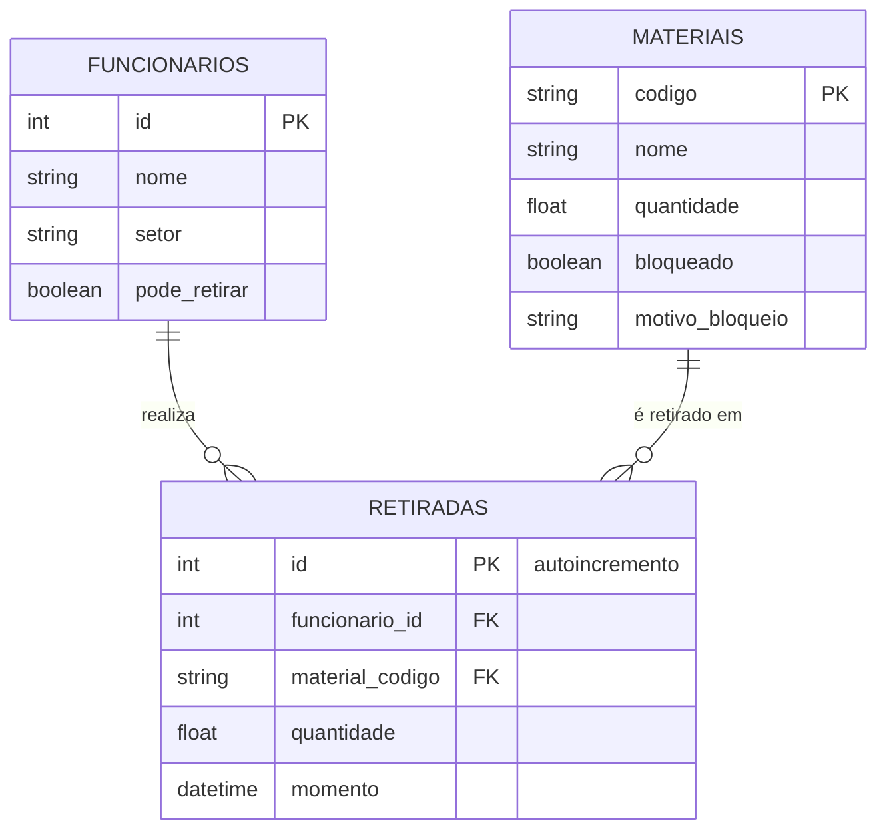

# Sistema de Almoxarifado

> Projeto Final da disciplina de Programação Orientada a Objetos — **Quarta versão: persistência em banco de dados com SQLAlchemy ORM**

## 👥 Equipe

| Integrante |
|---|
| Rafael Joaquim da Silva |
| Layse Vitória de Lima Oliveira |
| Kleiwan Paulo Justino Ludugero |

---

## 💻 Sobre o sistema

### Problema
O controle de materiais em um almoxarifado costuma ser feito de forma manual ou desorganizada (cadernos, planilhas soltas). Isso dificulta saber **quanto há em estoque**, **quem retirou o quê** e **quando**, e abre espaço para erros como retiradas acima do saldo disponível.

### Objetivo
Oferecer um sistema que permita cadastrar funcionários e materiais, registrar as retiradas de materiais feitas pelos funcionários e manter o estoque sempre consistente.

### Cenário de utilização
O sistema é utilizado pelo responsável do almoxarifado de uma organização. Ele cadastra os funcionários que podem solicitar materiais, cadastra os materiais com seu estoque inicial e, a cada solicitação, registra a retirada. O estoque é atualizado automaticamente e o histórico pode ser consultado por funcionário ou por material.

### Principais características
- Cadastro, listagem, consulta e remoção de **funcionários** (identificados por ID), com **permissão de retirada** que pode ser concedida ou retirada.
- Cadastro, listagem, consulta e remoção de **materiais** (identificados por código), com controle de estoque, reposição e **bloqueio/desbloqueio** com motivo.
- Registro de **retiradas**, associando um funcionário, um material, a quantidade e a data/hora.
- Consulta do histórico de retiradas por funcionário e por material.
- **Regras de negócio** validadas pelo sistema:
  - não permite cadastrar funcionário ou material duplicado;
  - não permite quantidade menor ou igual a zero;
  - não permite retirar mais do que o estoque disponível;
  - não permite retirar material bloqueado nem por funcionário sem permissão;
  - não permite remover funcionário ou material que já possua retiradas (o histórico é preservado);
  - a retirada grava o novo estoque e o registro da retirada na **mesma transação**.
- Interface de console (menus) e arquitetura em camadas.

---

## 🗄️ Banco de dados

Os dados são persistidos em **SQLite** (arquivo `sistema_alomoxarifado/dados/almoxarifado.db`) por meio do **SQLAlchemy ORM 2.x**. Os arquivos JSON da versão anterior foram removidos.

### Diagrama do banco de dados



### Descrição das tabelas

| Tabela | Chave primária | Chaves estrangeiras | Descrição |
|---|---|---|---|
| `funcionarios` | `id` (informado no cadastro) | — | Funcionários; `pode_retirar` indica se estão autorizados a retirar materiais. |
| `materiais` | `codigo` | — | Materiais; `quantidade` é o saldo atual; `bloqueado`/`motivo_bloqueio` controlam a situação. |
| `retiradas` | `id` (autoincremento) | `funcionario_id` → `funcionarios.id`<br>`material_codigo` → `materiais.codigo` | Cada retirada de um material por um funcionário, com quantidade e data/hora. |

### Relacionamentos e cardinalidades (`relationship` / `back_populates`)

- **Funcionario – Retirada (1:N):** `Funcionario.retiradas` ↔ `Retirada.funcionario`.
- **Material – Retirada (1:N):** `Material.retiradas` ↔ `Retirada.material`.

`Retirada` é a entidade associativa: o `quantidade` dela é o valor retirado, enquanto o `quantidade` de `Material` é o saldo em estoque.

### Configuração

- **Engine, criação das tabelas e sessões:** `persistencia/banco.py` (`create_engine`, `Base.metadata.create_all()` em `criar_tabelas()` e `criar_sessao()`).
- **Ciclo de vida da sessão:** `aplicacao.py` (`Aplicacao`, usada com `with`): abre uma sessão, entrega a mesma sessão aos três serviços e a fecha ao sair do bloco.
- **Arquivo do banco:** `dados/almoxarifado.db`, criado automaticamente na primeira execução (sem migrações).
- Cada serviço confirma com `commit()` e desfaz com `rollback()` em caso de falha.

---

## 📁 Estrutura do projeto

```
sistema_alomoxarifado/
├── main.py                     # abre a Aplicacao e inicia o menu
├── aplicacao.py                # sessão + serviços
├── requirements.txt
├── dados/
│   └── almoxarifado.db         # banco SQLite
├── modelos/                    # modelos ORM
│   ├── base.py                 # DeclarativeBase
│   ├── funcionario.py
│   ├── material.py
│   └── retirada.py
├── persistencia/
│   └── banco.py                # engine, criar_tabelas, criar_sessao
├── servicos/                   # regras de negócio + operações com a Session
├── excecoes/
├── interface/                  # menus e telas (não acessam sessão nem consultas)
└── testes/
    ├── teste_sistema.py
    └── consultar_banco.py
```

## ▶️ Como executar

Requer Python 3.10+.

```bash
cd sistema_alomoxarifado
python -m venv venv
.\venv\Scripts\activate        # Windows  (Linux/Mac: source venv/bin/activate)
pip install -r requirements.txt
python main.py
```

## ✅ Testes

Execute a partir de `sistema_alomoxarifado`, com o ambiente virtual ativado:

```bash
python -m testes.teste_sistema      # cadastros, consultas, atualizações, remoções, relacionamentos e regras de negócio
python -m testes.consultar_banco    # em outra execução: confirma que os dados permaneceram no banco
```
