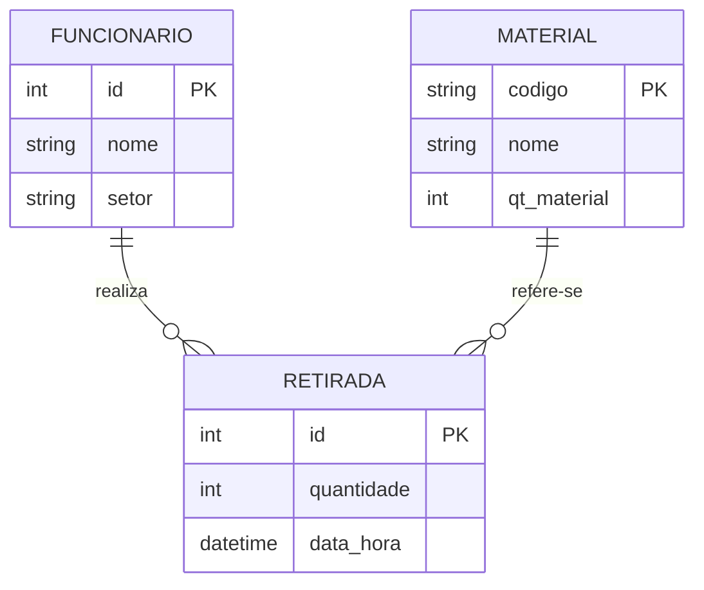
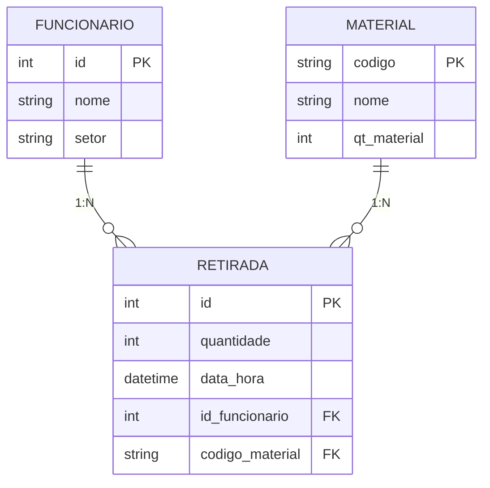

# Sistema de Almoxarifado — Terceira Versão — Rafael Joaquim da Silva, Layse Vitória de Lima Oliveira e Kleiwan Paulo Justino Ludugero 

## Sobre o projeto
O projeto tem como objetivo ajudar a gerenciar um almoxarifado, de forma que tudo possa ser armazenado e organizado de forma mais simples. O sistema permite cadastrar itens e usuarios além de gerenciar os mesmos para melhor controle. OS gerenciamentos possiveis são: Cadastrar usuario, listar usuario e buscar usuario; Cadastrar itens, retirar itens e listar os mesmos.

## Arquitetura

Na terceira versão foi adicionada a camada de **persistência**: os dados
deixam de existir apenas em memória e passam a ser gravados em arquivos
JSON, ficando disponíveis novamente na próxima execução. A arquitetura
evoluiu de 4 para 5 camadas:

```
   INTERFACE
       |
       ▼
    SERVIÇOS
       |
       ▼
   APLICAÇÃO
       |
       ▼
  PERSISTÊNCIA
       |
       ▼
 ARQUIVOS JSON
```

Os serviços **não conhecem os arquivos JSON**: eles pedem a gravação à
aplicação (`Almoxarifado`), que delega o trabalho à camada de persistência.

```
Tela → Service → Aplicação → Persistência → JSON
```

## Estrutura de pastas

```
sistema_alomoxarifado/
├── main.py
├── almoxarifado.py            # aplicação: dados em memória + coordena carregar/salvar
│
├── modelos/
│   ├── funcionario.py
│   ├── material.py
│   └── retirada.py
│
├── servicos/
│   ├── __init__.py             # instancia os serviços compartilhados
│   ├── funcionario_service.py
│   ├── material_service.py
│   └── retirada_service.py
│
├── persistencia/
│   ├── arquivo_json.py             # leitura/gravação segura de um .json
│   ├── validacao.py                # validação dos dados simples lidos
│   ├── funcionario_persistencia.py
│   ├── material_persistencia.py
│   └── retirada_persistencia.py
│
├── dados/                      # criada automaticamente na primeira execução
│   ├── funcionarios.json
│   ├── materiais.json
│   └── retiradas.json
│
├── excecoes/
│   └── almoxarifado__error.py
│
└── interface/
    ├── menu.py
    ├── tela.py
    ├── menus/
    │   ├── menu_principal.py
    │   ├── menu_funcionarios.py
    │   ├── menu_materiais.py
    │   └── menu_retirada.py
    └── telas/
        ├── tela_pricipal.py
        ├── tela_funcionario.py
        ├── tela_materiais.py
        └── tela_retiradas.py
```

## Responsabilidades

- **Modelos**: representam os objetos do domínio e seus comportamentos
  próprios. `Material` controla sua própria quantidade em estoque
  (`adicionar_estoque` / `retirar_estoque`), levantando exceções quando
  uma operação é inválida. `Retirada` passou a ter um `id` próprio.
- **Aplicação (`Almoxarifado`)**: mantém as listas de funcionários,
  materiais e retiradas em memória, com atributos privados e acesso
  controlado por propriedades/métodos. Ao ser criada chama
  `carregar_dados()`; expõe `salvar_funcionarios()`, `salvar_materiais()`,
  `salvar_retiradas()` e `salvar_dados()`.
- **Serviços**: coordenam operações e regras de negócio. Por exemplo,
  `RetiradaService.registrar` localiza o funcionário e o material,
  verifica a quantidade e o estoque, cria a retirada, adiciona à
  aplicação e solicita a gravação. Os serviços nunca abrem arquivos JSON.
- **Persistência**: transforma objetos em dados simples e JSON, e o
  processo inverso (`Objeto ↔ Dados simples ↔ JSON`). Não exibe mensagens
  ao usuário; apenas levanta exceções. Usa somente os mecanismos públicos
  da aplicação (propriedades que devolvem cópias das listas).
- **Exceções**: representam violações de regras de negócio
  (`FuncionarioJaCadastradoError`, `MaterialNaoEncontradoError`,
  `EstoqueInsuficienteError`, `QuantidadeInvalidaError`, etc.) e problemas
  de persistência (veja abaixo). Os serviços e a persistência levantam as
  exceções; a interface captura e exibe uma mensagem adequada.
- **Interface**: menus e telas cuidam exclusivamente da interação com
  o usuário, delegando toda a lógica aos serviços.

## Persistência em JSON

Os arquivos ficam na pasta `dados/` (ao lado de `almoxarifado.py`) e são
criados automaticamente quando ainda não existem.

**funcionarios.json**
```json
[
    {"id": 3, "nome": "Ana", "setor": "TI", "pode_retirar": true}
]
```

**materiais.json**
```json
[
    {"codigo": "P01", "nome": "Papel A4", "quantidade": 42.5}
]
```

**retiradas.json**
```json
[
    {
        "id": 1,
        "funcionario_id": 3,
        "material_codigo": "P01",
        "quantidade": 7.5,
        "momento": "2026-10-11T21:49:43.123456"
    }
]
```

A retirada **não guarda cópia** do funcionário nem do material: apenas
`funcionario_id` e `material_codigo`, que correspondem às chaves
estrangeiras do modelo lógico.

### Carregamento

```
Iniciar programa
      ↓
Criar aplicação
      ↓
Carregar funcionários
      ↓
Carregar materiais
      ↓
Carregar retiradas
      ↓
Reconstruir relacionamentos (funcionario_id → Funcionario, material_codigo → Material)
      ↓
Iniciar interface
```

Os dados só substituem os da memória se **todos** os arquivos forem lidos
com sucesso.

### Gravação

Cada operação que altera dados solicita a gravação dos arquivos afetados:

```
Cadastrar funcionário → Funcionário criado → Aplicação atualizada → funcionarios.json atualizado
Cadastrar material    → Material criado    → Aplicação atualizada → materiais.json atualizado
Registrar retirada    → Retirada criada    → Aplicação atualizada → materiais.json + retiradas.json atualizados
```

A gravação é feita em arquivo temporário seguido de renomeação, evitando
que uma falha no meio da escrita corrompa os dados já salvos.

### Tratamento de erros de persistência

| Situação | Comportamento |
|---|---|
| Arquivo inexistente | Criado automaticamente com lista vazia |
| Arquivo vazio | Tratado como lista vazia |
| JSON inválido | `JsonInvalidoError` |
| Dados incompatíveis com o modelo (campo ausente, tipo errado, ID/código duplicado, quantidade inválida, data inválida) | `DadosIncompativeisError` |
| Relacionamento para objeto inexistente | `RelacionamentoInvalidoError` |
| Falha ao ler/gravar o arquivo (permissão, disco etc.) | `ArquivoPersistenciaError` |

Todas herdam de `PersistenciaError`. A camada de persistência não exibe
mensagens: a interface (`main.py` na inicialização e os menus durante a
execução) captura as exceções e apresenta a mensagem ao usuário. Em caso
de arquivo corrompido, o sistema **não sobrescreve** o arquivo — avisa o
usuário e encerra, para que nenhum dado seja perdido.

## Permissão de retirada de materiais

Nem todo funcionário está autorizado a retirar materiais. Cada
`Funcionario` possui o atributo `pode_retirar` (booleano), alterado apenas
pelos métodos `conceder_permissao()` e `retirar_permissao()` do próprio modelo.

| Camada | O que mudou |
|---|---|
| Modelo | `Funcionario.pode_retirar`, `conceder_permissao()`, `retirar_permissao()`; `printar()` mostra AUTORIZADO / NAO AUTORIZADO |
| Exceção | `FuncionarioSemPermissaoError` |
| Serviço | `FuncionarioService.conceder_permissao(id)` e `retirar_permissao(id)` alteram e gravam em `funcionarios.json` |
| Serviço | `RetiradaService.registrar` recusa a retirada com `FuncionarioSemPermissaoError` **antes** de mexer no estoque |
| Persistência | `pode_retirar` é gravado e lido em `funcionarios.json` |
| Interface | Menu de funcionários: `[5]` conceder e `[6]` retirar permissão; o menu de retiradas exibe a mensagem de recusa |

Pontos de projeto:

- **A regra está no serviço**, não na interface: qualquer código que chame
  `retirada_service.registrar(...)` é barrado, mesmo sem passar pelos menus.
- A verificação **não** fica no construtor de `Retirada`, porque ao carregar
  `retiradas.json` as retiradas antigas de quem perdeu a permissão precisam
  continuar sendo reconstruídas.
- Retirar a permissão **não apaga** o funcionário nem suas retiradas; elas
  continuam consultáveis.
- Funcionários gravados antes desta versão (sem o campo `pode_retirar`) são
  carregados como **autorizados**, preservando o comportamento anterior. Novos
  funcionários também nascem autorizados. Se o campo existir com tipo
  inválido, o carregamento falha com `DadosIncompativeisError`.
- Os materiais não receberam nenhum atributo de bloqueio.

## Fluxo testado

```
Cadastrar funcionário
        ↓
Cadastrar material (com estoque inicial)
        ↓
Registrar retirada válida
        ↓
Consultar estoque
        ↓
Tentar retirar quantidade superior ao estoque
        ↓
Exceção (EstoqueInsuficienteError) apresentada pela interface
        ↓
Encerrar e abrir o programa novamente
        ↓
Funcionários, materiais, retiradas e estoque continuam disponíveis
```

## Execução

O ponto de entrada continua sendo o mesmo da primeira versão:

```
python main.py
```



## Sobre os diagramas
No modelo conceitual (DER), foram identificadas três entidades — FUNCIONARIO, MATERIAL e RETIRADA — conectadas por dois relacionamentos binários do tipo 1:N: "realiza" (entre FUNCIONARIO e RETIRADA) e "refere-se" (entre MATERIAL e RETIRADA).

Na transformação para o modelo lógico relacional, cada entidade do DER originou uma relação (tabela), e seus atributos identificadores (id, codigo) tornaram-se as chaves primárias correspondentes. Como ambos os relacionamentos possuem cardinalidade máxima 1 do lado de FUNCIONARIO e MATERIAL, e cardinalidade máxima N do lado de RETIRADA, aplicou-se a regra de que a chave primária do lado "1" migra como chave estrangeira para a tabela do lado "N". Por isso, a relação RETIRADA recebeu os atributos id_funcionario e codigo_material como chaves estrangeiras, referenciando respectivamente FUNCIONARIO(id) e MATERIAL(codigo). Não foi necessária a criação de tabelas associativas, pois nenhum dos relacionamentos é N:N.

## Bloqueio e desbloqueio de materiais

No menu **Materiais**, as opções 5 e 6 permitem bloquear e desbloquear itens.
O bloqueio exige um motivo, que é apresentado quando uma retirada é recusada.
A situação do material e o motivo ficam salvos em `dados/materiais.json`.
Materiais de arquivos JSON antigos, sem os campos de bloqueio, são carregados
como desbloqueados para manter a compatibilidade.
